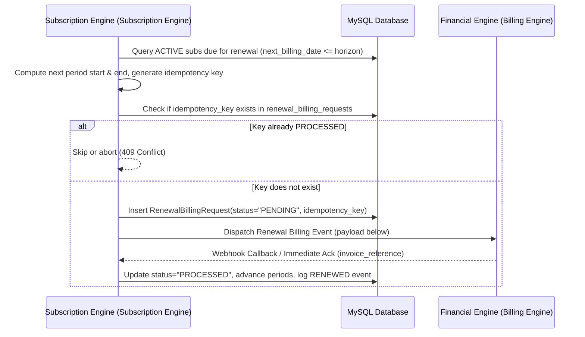

# Brightloop Nexus — Subscription Engine to Financial Engine Integration Contract
**Platform**: Brightloop Nexus Intelligent Subscription & Revenue Management Platform  
**Subscription Engine Role**: Subscription & Intelligence Engine  
**Financial Engine Role**: Billing, Invoicing, Tax, & Revenue Analytics Engine  
**Database**: MySQL 8.0+ (InnoDB, `utf8mb4`, `DECIMAL(12,2)`)

---

## 1. Architectural Boundaries & Responsibility Separation

| Scope | Subscription Engine Responsibility (This Engine) | Financial Engine Responsibility |
| :--- | :--- | :--- |
| **Identity & Access** | Customer profiles, authentication (JWT/bcrypt), RBAC (`ADMIN`, `STAFF`, `CUSTOMER`). | Payment gateway credentials, payment methods tokenization. |
| **Catalog & Plans** | Products, variant pricing, subscription plans (intervals, policies). | Plan discounts, promotion codes, tax categories. |
| **Quotations** | Quotation builder, line totals, expiration guards, conversion to subscription. | Quotation tax computation (`tax_amount`, `tax_reference`). |
| **Subscriptions** | Lifecycle state machine (`DRAFT` $\rightarrow$ `CONFIRMED` $\rightarrow$ `ACTIVE` $\rightleftharpoons$ `PAUSED` $\rightarrow$ `CLOSED`/`CANCELLED`). | Invoice generation, revenue recognition, collection receipts. |
| **Renewals** | Automated scheduler, due date detection, idempotency key generation. | Invoice dispatch, payment retry logic, payment webhooks. |
| **Intelligence** | Churn Radar risk scoring (0–100), Time Machine audit replay. | MRR/ARR financial reporting, cohorts, accounting ledgers. |

---

## 2. Renewal Billing Request Protocol (Idempotency Contract)

Subscription Engine generates and stores renewal requests in `renewal_billing_requests` table with a deterministic idempotency key before dispatching to Financial Engine.

### Idempotency Key Format
```
REN-SUB{subscription_id}-{YYYYMMDD_period_start}-{YYYYMMDD_period_end}
```
*Example*: `REN-SUB42-20261101-20261201`

### Lifecycle Flow


### Outgoing Payload (Subscription Engine $\rightarrow$ Financial Engine)
```json
{
  "idempotency_key": "REN-SUB42-20261101-20261201",
  "subscription_id": 42,
  "subscription_number": "SUB-2026-0042",
  "customer_id": 15,
  "customer_code": "CUST-2026-0015",
  "billing_period_start": "2026-11-01T00:00:00Z",
  "billing_period_end": "2026-12-01T00:00:00Z",
  "amount": "299.00",
  "currency": "USD",
  "payment_terms": "Immediate"
}
```

### Incoming Webhook Callback (Financial Engine $\rightarrow$ Subscription Engine)
Endpoint: `POST /api/v1/renewals/member2-webhook`

**Success Body**:
```json
{
  "idempotency_key": "REN-SUB42-20261101-20261201",
  "invoice_reference": "INV-M2-998822AA",
  "status": "SUCCESS"
}
```

**Failure Body**:
```json
{
  "idempotency_key": "REN-SUB42-20261101-20261201",
  "invoice_reference": null,
  "status": "FAILED",
  "error_message": "Card expired on payment gateway"
}
```

---

## 3. Quotation Tax & Discount Contract

When a quotation is created or finalized, Subscription Engine provides the base product & variant lines:

- Base sales price from `products.sales_price`
- Variant additional price from `product_variants.additional_price`
- Unit price = `sales_price + additional_price`
- Line subtotal = `unit_price * quantity`
- Quotation `subtotal` = $\sum \text{Line Subtotals}$

Financial Engine populates:
- `quotations.tax_reference`: Regulatory tax category or external tax calculation ID.
- `quotations.tax_amount`: Computed tax (Decimal 12,2).
- `quotations.total`: `subtotal + tax_amount - discount_amount`.

---

## 4. Time Machine Append-Only Event Store

Every transition executed by either Subscription Engine or Financial Engine writes an immutable row into `subscription_events`:

```sql
INSERT INTO subscription_events (
  subscription_id, event_type, previous_state, new_state, actor_email, actor_role, reason, metadata_json, created_at
) VALUES (...);
```

Supported Event Types:
- `CREATED`: Initial draft state
- `CONFIRMED`: Quotation or draft confirmed
- `ACTIVATED`: Activated for production service
- `PAUSED`: Temporarily paused by customer or staff
- `RESUMED`: Resumed from hiatus
- `RENEWED`: Successfully advanced to next billing cycle with invoice reference
- `CANCELLED`: Terminated prior to or upon completion
- `CLOSED`: Terminated normally at contract completion
- `RETENTION_ACTION`: Logged outreach from Churn Radar

