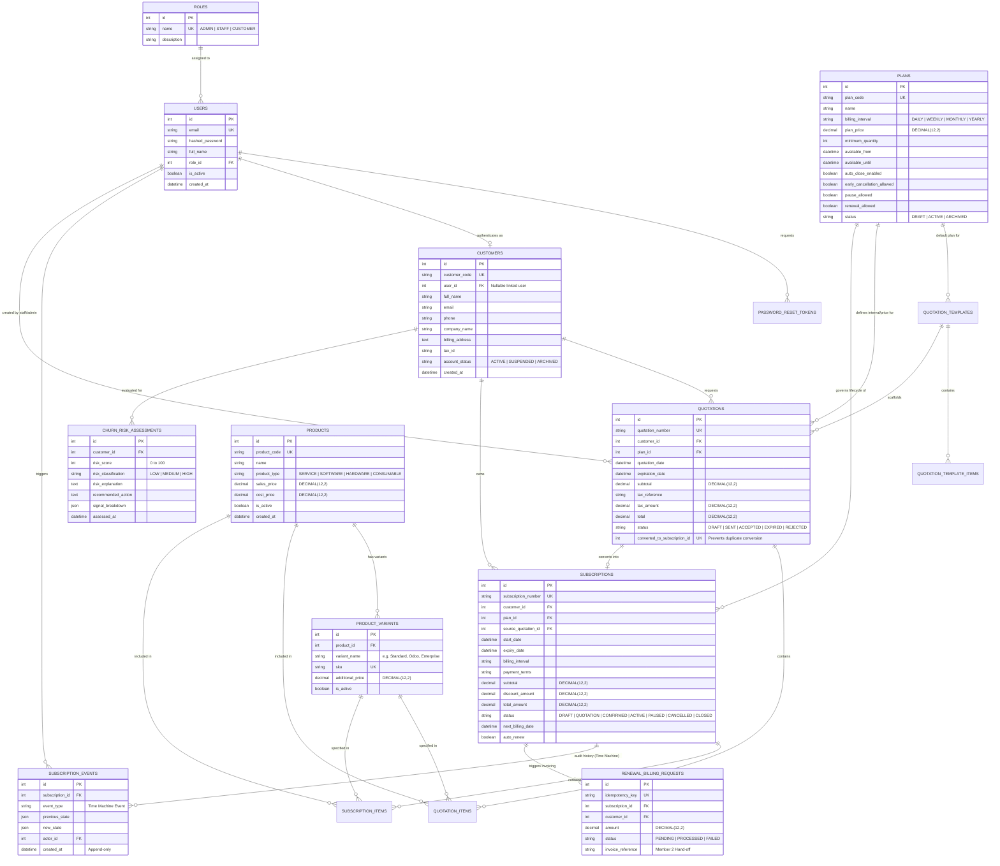

# Brightloop Nexus — Database Architecture & ER Design
**Member 1: Subscription & Intelligence Engine**
**Database Engine**: MySQL 8.0+ (InnoDB Storage Engine)
**Driver**: PyMySQL with SQLAlchemy 2.0
**Migration Tool**: Alembic
**Monetary Precision**: `DECIMAL(12, 2)`

---

## 1. Relational Database Concepts for Beginners

When building financial and subscription systems, data integrity is paramount:

1. **Storage Engine (InnoDB)**:
   - Provides ACID compliance (Atomicity, Consistency, Isolation, Durability).
   - Guarantees crash recovery and transaction rollback. If any step of subscription activation fails, changes are completely rolled back.
   - Enforces foreign key constraints at the database engine level.

2. **Monetary Precision (`DECIMAL(12, 2)`)**:
   - Floating point numbers (`FLOAT`, `DOUBLE`) suffer from binary representation rounding errors (e.g., `0.1 + 0.2 = 0.30000000000000004`).
   - `DECIMAL(12, 2)` stores exact fixed-point base-10 numbers, ensuring zero financial discrepancy during plan pricing, discounts, and renewal calculations.

3. **Character Set (`utf8mb4`) & Collation (`utf8mb4_unicode_ci`)**:
   - Supports 4-byte UTF-8, including international names, multilingual company names, and emojis without data corruption.

4. **Primary Keys & Foreign Keys**:
   - `id INT AUTO_INCREMENT PRIMARY KEY`: Ensures each record has a unique, fast-indexing identifier.
   - `FOREIGN KEY (customer_id) REFERENCES customers(id)`: Prevents orphaned records. A subscription cannot point to a non-existent customer.

5. **Indexes**:
   - Added on columns frequently searched or filtered: `email`, `subscription_number`, `quotation_number`, `status`, and foreign keys.

---

## 2. Entity-Relationship (ER) Diagram

---

## 3. Coordinated Hand-off with Member 2 (Financial Engine)

| Responsibility | Owner | Integration Contract |
|---|---|---|
| Customer Profile & Address | **Member 1** | Exposes customer ID, billing address, tax identification |
| Plan, Products & Quantities | **Member 1** | Exposes subscription items, pricing, billing interval |
| Renewal Trigger & Due Subscriptions | **Member 1** | Exposes `GET /api/v1/renewals/due` with `idempotency_key` |
| Tax Calculations & Rules | **Member 2** | Member 1 calls `POST /api/v1/taxes/calculate` or references tax rule IDs |
| Invoices & Line Items | **Member 2** | Member 2 creates Invoices matching Member 1's subscription items |
| Payment Collection & Gateways | **Member 2** | Member 2 processes transactions and reconciliation |
| Churn Payment Signals | **Member 2** | Member 2 exposes failed payment count and days overdue for Churn Radar |

